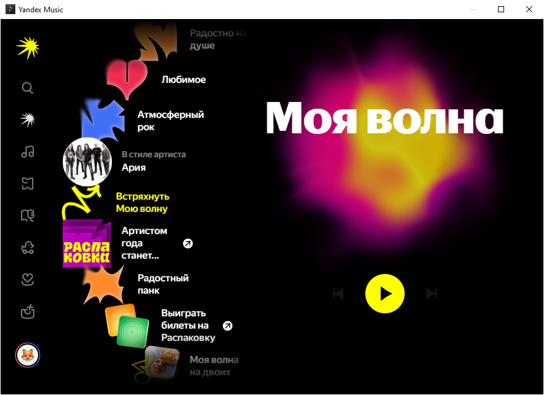
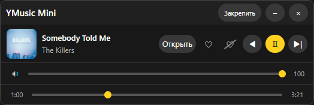

# 🎵 YMusicMiniWeb

**Неофициальный компактный десктоп-клиент Яндекс.Музыки для Windows с плавающим мини-пультом управления.**

Управляй музыкой, переключай треки, ставь лайки, регулируй громкость и перематывай воспроизведение, не переключаясь между окнами.

[Особенности](#-особенности) · [Скриншоты](#-скриншоты) · [Установка](#-установка) · [Сборка](#-сборка) · [Как это работает](#-как-это-работает) · [Лицензия](#-лицензия)

---

## ✨ Особенности

- **Полноценный музыкальный сервис** — официальный сайт Яндекс.Музыки со всеми привычными функциями: «Моя волна», плейлисты, поиск, профиль и подписка.
- **Плавающий мини-пульт** — компактное окно без рамок с обложкой альбома, названием трека и кнопками управления.
- **Управление воспроизведением** — предыдущий трек, пауза/воспроизведение и следующий трек.
- **Перемотка трека** — управление текущей позицией воспроизведения с помощью слайдера.
- **Лайк и дизлайк** — управление отметками «Мне нравится» и «Не нравится» непосредственно из мини-пульта.
- **Синхронизация** — обложка, исполнитель, название трека, состояние воспроизведения и отметки автоматически обновляются.
- **Управление в фоне** — основное окно музыки можно скрыть, оставив мини-пульт доступным.
- **Поверх всех окон** — возможность закрепить мини-пульт поверх остальных приложений.
- **Прилипание к краям экрана** — мини-пульт автоматически фиксируется возле края экрана или панели задач.
- **Регулировка громкости** — управление громкостью непосредственно через аудиосессию приложения Windows.

## 🖼️ Скриншоты

### Основное окно

<p align="center">
  
</p>

### Плавающий мини-пульт

<p align="center">
  
</p>

## 🚀 Установка

### Системные требования

- Windows 10/11 (64-bit).
- Microsoft Edge WebView2 Runtime.
- Python 3.9 или новее — только для запуска из исходников.

### Вариант 1. Запуск из исходников

1. Клонируй репозиторий:

```powershell
git clone https://github.com/irbidos/YMusicMiniWeb.git
cd YMusicMiniWeb
```

2. Создай виртуальное окружение:

```powershell
python -m venv venv
```

3. Активируй виртуальное окружение.

Для PowerShell:

```powershell
.\venv\Scripts\Activate.ps1
```

Для CMD:

```cmd
venv\Scripts\activate.bat
```

4. Установи зависимости:

```powershell
pip install -r requirements.txt
```

5. Запусти приложение:

```powershell
python run_yandex_web.py
```

### Вариант 2. Готовая сборка

Если доступна готовая версия, её можно скачать в разделе [Releases](https://github.com/irbidos/YMusicMiniWeb/releases).

Запусти `YMusicMiniWeb.exe`. Устанавливать Python и дополнительные библиотеки для запуска не требуется.

Для работы приложения необходим Microsoft Edge WebView2 Runtime.

## 📦 Сборка EXE

Для самостоятельной сборки приложения:

1. Установи зависимости:

```powershell
pip install -r requirements.txt
pip install pyinstaller
```

2. Выполни сборку:

```powershell
pyinstaller YMusicMiniWeb.spec
```

Готовый исполняемый файл появится в папке:

```text
dist\YMusicMiniWeb.exe
```

При первом запуске EXE распаковывает необходимые компоненты во временную папку Windows (`%TEMP%\_MEI...`). Поэтому первый запуск может занимать немного больше времени.

## 🔧 Как это работает

Приложение открывает официальный сайт Яндекс.Музыки в отдельном окне WebView2 и запускает плавающий мини-пульт для управления воспроизведением.

Основное окно можно скрыть, оставив мини-пульт на рабочем столе.

### Управление воспроизведением

Для взаимодействия с музыкальным плеером используются несколько механизмов:

- **Кнопки плеера** — приложение находит элементы управления по `aria-label`, определяет их координаты и отправляет Win32-клики.
- **Медиа-команды Windows** — используются системные команды `APPCOMMAND_MEDIA_*` для управления воспроизведением.
- **Клавиша Space** — резервный способ управления паузой и воспроизведением.

### Информация о треке

Название композиции, исполнитель, обложка и состояние воспроизведения поступают через Media Session API страницы.

### Управление громкостью

Регулировка громкости реализована через Windows Core Audio API с использованием библиотеки `pycaw`.

Приложение изменяет громкость непосредственно аудиосессии WebView2 в микшере Windows, независимо от HTML-разметки музыкального сайта.

## 🔐 Авторизация

Авторизация выполняется непосредственно на официальном сайте Яндекс.Музыки внутри WebView2.

- Вход выполняется штатным способом через страницу Яндекса.
- Пароль вводится непосредственно на сайте.
- Сессия авторизации хранится в профиле WebView2.
- Ручной ввод OAuth-токенов не требуется.

## ⚠️ Важная информация

YMusicMiniWeb — неофициальный проект, созданный для личного удобства пользователей.

Проект не является продуктом Яндекса, не поддерживается и не одобряется компанией Яндекс.

Яндекс.Музыка и связанные с ней товарные знаки принадлежат их правообладателям.

## 📄 Лицензия

Проект распространяется под лицензией [MIT](LICENSE).

Использование, изменение и распространение исходного кода разрешены в соответствии с условиями лицензии.

Существующие уведомления об авторских правах и атрибуция исходных компонентов должны сохраняться в соответствии с условиями их лицензий.

---

**Приятного использования! ❤️**

**Теги:** yandex-music yandex-music-player music-player mini-player miniplayer desktop-app windows python webview2 pywebview
